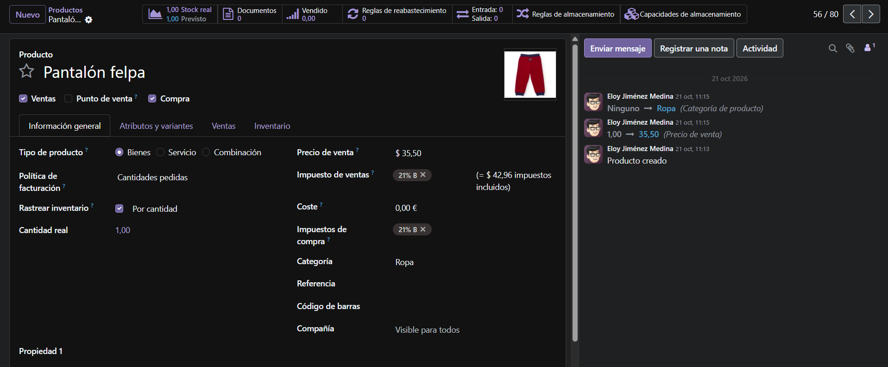
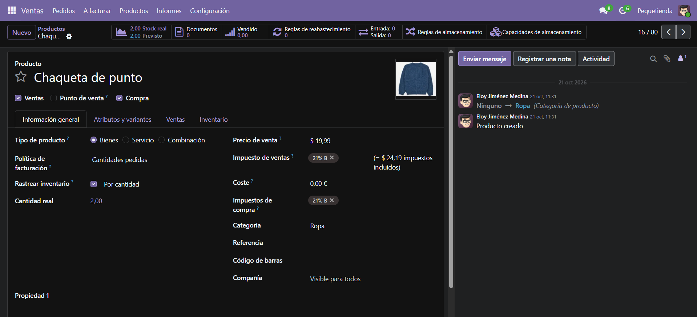
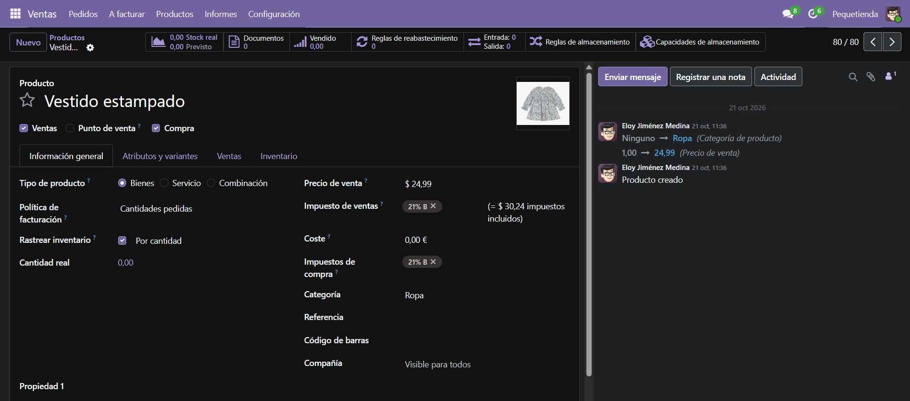
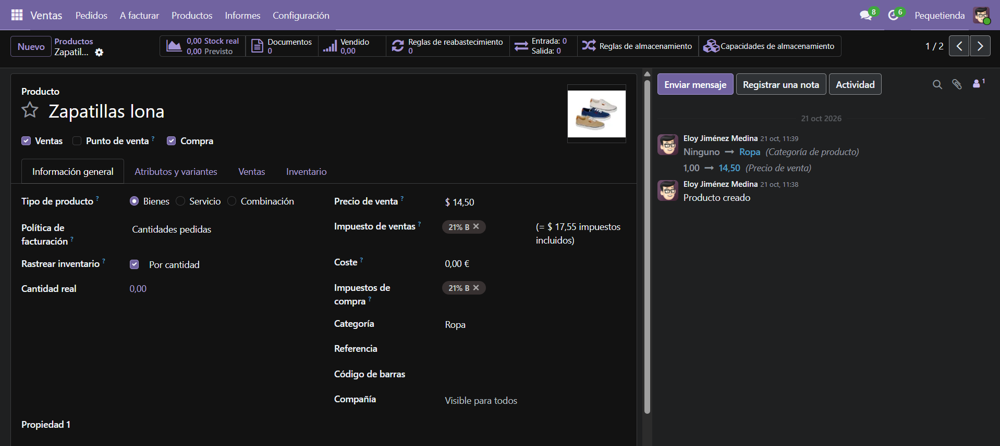

# Ficha empresa
  
__Nombre de empresa:__ Pequetienda  
__Sector:__ Moda infantil  
__Actividad:__ Venta al por menor de ropa infantil  
__Datos ficticios:__
* Nombre de la empresa: Pequetienda
* Dirección: A Calle Informática Nº23, 41020 Sevilla, Sevilla (ES), España.
* NIF: ES00000000T
* Moneda: EUR
* Teléfono: +34 634 63 92 47
* Correo electrónico: info@pequetienda.com
* Sitio web: http://www.pequetienda.com
* Dominio de correo electrónico: pequetienda.com  

__Catálogo:__  
* __Pantalón felpa:__  
Tipo: Bienes  
Precio de venta: 35,50$  
Impuestos: 21% (42,96$ precio con impuestos)  
Categoría: Ropa  
Stock real: 1 
  

* __Chaqueta de punto:__  
Tipo: Bienes  
Precio de venta: 19,99$  
Impuestos: 21% (24,19$ precio con impuestos)  
Categoría: Ropa  
Stock real: 2 
  

* __Vestido estampado:__  
Tipo: Bienes  
Precio de venta: 24,99$  
Impuestos: 21% (30,24$ precio con impuestos)  
Categoría: Ropa  
Stock real: 0 
  

* __Zapatillas lona:__  
Tipo: Bienes  
Precio de venta: 14,50$  
Impuestos: 21% (17,55$ precio con impuestos)  
Categoría: Ropa  
Stock real: 0 
  