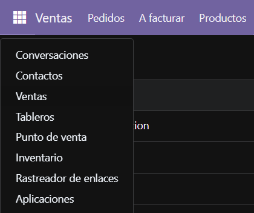
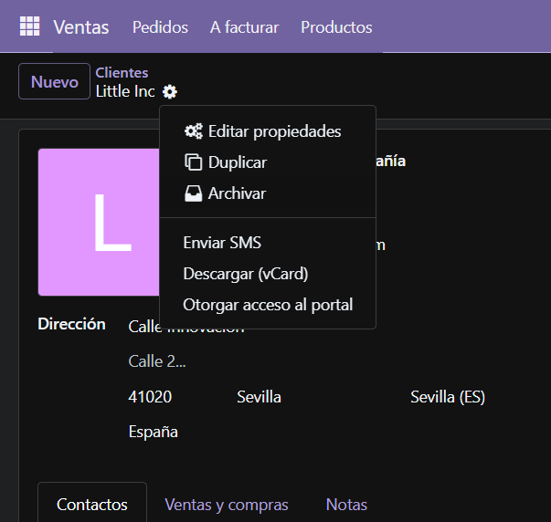
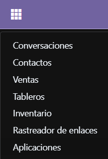
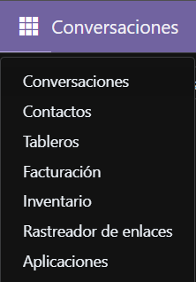

# Usuarios, grupos y permisos
## Tabla usuarios
| Usuario | Puesto | Tipo | Grupo/Privilegios | Justificación |
| :--- | :--- | :--- | :--- | :--- |
| Comercial Juan | Comercial junior | Interno | __Ventas:__ Propios  __Contabilidad:__ Ninguno | Solo puede ver documentos propios y ni tiene acceso a contabilidad |
| Responsable Fernando | Responsable ventas | Interno | __Ventas:__ Administrador | Tiene acceso global a presupuestos y supervisión de ventas |
| Facturación Eloy | Facturación | Interno | __Contabilidad:__ Facturación  __Ventas:__ Acceso a presupuestos | Aplica el mínimo privilegio permitiendo facturar sin gestionar ventas (tuve que darle permiso en ventas porque no dejaba generar la factura en base al pedido ya que no tenía acceso a él y por ende no podía dejar el pedido en el estado final de facturado al no tener factura relacionada). |

## Tipos de usuario en Odoo
* __Interno:__ Estos usuarios tienen acceso a la interfaz de gestión del Odoo y están destinados al personal de la empresa.
* __Portal:__ Este tipo de uusario esta diseñado para clientes y proveedores externos, los cuales no tienen acceso a la interfaz de gestión de Odoo, sino que acceden a un portal o sitio web seguro en el que consultan sus pedidos, presupuestos y facturas.
* __Público:__ Este tipo de usuario esta diseñado para los visitantes anónimos que acceden unicamente a la tienda online de la empresa.

## Derechos de acceso del grupo propio
| Nombre del Registro | Modelo Técnico | Lectura (L) | Escritura (E) | Creación (C) | Borrado (B) | Justificación |
| :--- | :--- | :---: | :---: | :---: | :---: | :--- |
| **Acceso a Contactos (Junior)** | `res.partner` | Sí | Sí | Sí | **No** | El comercial junior necesita dar de alta y modificar clientes para sus ventas, pero se le prohíbe borrarlos para evitar pérdidas accidentales de datos maestros. |
| **Acceso a Presupuestos (Junior)** | `sale.order` | Sí | Sí | Sí | **No** | Puede generar y editar sus propias ofertas comerciales, pero carece de permisos de eliminación sobre los registros de venta históricos. |

## Demostración de permisos restringidos en usuarios
### Comercial Juan
Al iniciar sesión, el sistema Odoo oculta automáticamente el módulo Facturación (Contabilidad) del menú desplegable del lado superior izquierdo de la interfaz.  
  

También, si accedemos a la configuración de un cliente y lo intentamos eliminar, al igual que con el módulo Facturación, Odoo ocultará la opción al no disponer de los permisos necesarios.  

### Responsable Fernando
AL igual que con el usuario "Comercial Juan", cuando se inicia sesión con este usuario, Odoo oculta automáticamente el módulo de Facturación (Contabilidad) en el menú desplegable del lado superior izquierdo de la interfaz.  

### Facturación Eloy
Cuando se inicia sesión con este usuario, el sistema Odoo oculta automáticamente el módulo Ventas en el menú desplegable del lado superior izquierdo de la interfaz, imposibilitando su acceso.  
